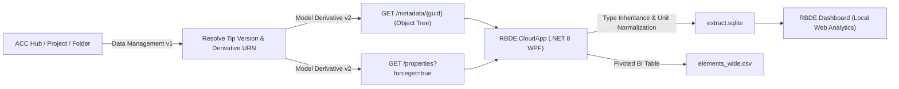

# APS Cloud Batch Data Extractor (`RBDE`)

[](LICENSE)
[](https://dotnet.microsoft.com/)
[](https://aps.autodesk.com/)

High-speed, zero-download BIM parameter and quantity extractor for **Autodesk Construction Cloud (ACC) / BIM 360** and local **Revit 2026** workflows. Built to extract multi-discipline AEC categories, Type + Instance parameters, and pivoted flat tables (`elements_wide.csv` & `extract.sqlite`) in seconds for QA/QC auditing and Power BI / Excel visualization.

---

## 1. Problem Statement

Extracting BIM metadata across **30+ federated Revit models every week** faces three critical bottlenecks in traditional workflows:

1. **Local Opening & Downloading Bottleneck:** Downloading 30+ models (200–500 MB each = 6–15 GB/week) and opening each file sequentially in desktop Revit takes hours, locks artist workstations, and crashes on missing links or dialogs.
2. **APS Design Automation Queue Latency:** Running a headless Revit `.bundle` on APS Design Automation requires spinning up a cloud Revit VM, downloading the `.rvt` file into the worker, and waiting in global engine queues (observed **10+ minutes queue wait** at peak hours, risking S3 pre-signed URL expiration and consuming paid Flex tokens per hour).
3. **Rigid Schema Across Disciplines:** Fixed extraction scripts fail when switching between Architecture, Structure, MEP, Interior, and Cost Estimation (QTO) models, each requiring different categories and custom shared parameters as table columns.

---

## 2. Requirements & Architectural Approach

### Core Requirements
* **Zero File Download & Zero Revit Boot:** Extract element hierarchy and parameters directly from ACC cloud models in **< 20 seconds per model**.
* **Multi-Discipline AEC Scalability:** Cover 65+ standard Revit categories (Architecture, Structure, MEP, Interior, Site) plus dynamic schema discovery for custom model categories and shared parameters.
* **Type-to-Instance Inheritance:** Automatically merge `Type` parameters (`Type Mark`, `Fire Rating`, `Assembly Code`, `Structural Material`, `Width`, `Height`, `Cost`) onto child `Instance` rows so flat BI tables are complete.
* **Flexible Column Headers:** Allow users to customize priority column headers per run and toggle columns dynamically in a web review dashboard.
* **Strict Credential Isolation:** Never store `APS_CLIENT_ID` or `APS_CLIENT_SECRET` in source files; persist credentials exclusively in the local user's OS environment (`EnvironmentVariableTarget.User`).

### Solution Architecture
Instead of booting Revit in the cloud, `RBDE.CloudApp` queries the **APS Data Management API** and **APS Model Derivative REST API** directly:



---

## 3. Benchmark & Testing Results

Tested against a production-scale **357.62 MB Revit 2026 Architecture model** hosted on ACC (`17,425` elements across `31` categories):

| Metric | Manual / Local Batch | APS Design Automation (Cloud VM) | APS Model Derivative REST (`RBDE.CloudApp`) |
| :--- | :--- | :--- | :--- |
| **Local RVT Download** | 357.62 MB per file | 0 MB (Cloud S3 to VM) | **0 MB** |
| **Queue & Boot Time** | 3–6 min per model | 8–12 min (Global queue pos ~100+) | **0 sec (Instant HTTP GET)** |
| **Extraction Time (1 Model)** | ~4–7 min | ~10+ min (Queue + VM boot) | **8.4 – 20.1 seconds** |
| **Estimated Time (30 Models)** | ~2.5 – 3.5 hours | ~15 – 45 min (parallel queued) | **~3 – 6 minutes** |
| **Cloud Compute Cost** | Workstation locked | Paid Flex Tokens / VM-hour | **$0.00 (Free GET on ACC views)** |

---

## 4. Toolchain & Repository Structure

| Component | Path | Description |
| :--- | :--- | :--- |
| **Cloud Batch App (WPF)** | `src/CloudApp/` | `.NET 8` desktop UI with Hub/Project/Folder dropdowns, multi-model selector, 65+ AEC category presets, live schema scanner, custom priority column headers, and credential manager. |
| **Analytics Dashboard** | `src/Dashboard/` | Local `.NET 8` HTTP + SQLite web server (`index.html` + `Program.cs`) featuring dynamic column toggling, QA/QC parameter completeness charts, QTO rollups (`Area`, `Volume`, `Length`), and Wide CSV export. |
| **Core Data Store** | `src/Core/` | Shared SQLite WAL store, configuration models, and CSV serializers. |
| **Local Revit Add-in** | `src/Revit/` | Optional in-process Revit 2026 `IExternalCommand` extractor for offline local models. |
| **DA AppBundle** | `src/Automation/` | Optional `IExternalDBApplication` headless worker for APS Design Automation when unindexed internal geometry is required. |
| **PowerShell CLI Scripts** | `cloud/` | Standalone CLI scripts (`Test-ApsConnection.ps1`, `Extract-ModelDerivative.ps1`, `Deploy-AppBundle.ps1`, `Submit-WorkItem.ps1`). |

---

## 5. Quick Start & User Guide

### Step 1: Configure APS App & ACC Custom Integration
1. Sign in to the [Autodesk Platform Services Developer Portal](https://aps.autodesk.com/) and create a **Server-to-Server (2-Legged OAuth)** application with **Data Management API** and **Model Derivative API** enabled.
2. Copy your **Client ID** and **Client Secret**.
3. In **Autodesk Construction Cloud (ACC) Account Admin** -> **Custom Integrations**, register your **Client ID** with access to **DOCS / Project Administration** so your 2-legged token can read project folders.

### Step 2: Build & Launch the Desktop App
```powershell
# Build the Analytics Dashboard and Desktop Extractor
dotnet build src/Dashboard/Dashboard.csproj -c Release
dotnet publish src/CloudApp/CloudApp.csproj -c Release -o bin/CloudApp

# Launch the WPF Application
./bin/CloudApp/RBDE.CloudApp.exe
```

### Step 3: Authenticate & Extract Models
1. Click **Configure Credentials** in the top-right corner of the app.
2. Enter your `APS Client ID` and `APS Client Secret` and click **Save & Sync with Hub** (saved securely to your local Windows User environment variables `APS_CLIENT_ID` and `APS_CLIENT_SECRET`).
3. Select your **Hub**, **Project**, and **Folder** from the dropdowns.
4. *(Optional)* Click **Scan Model Schema** to inspect all live categories and parameters present in the selected `.rvt` model.
5. Choose a **Discipline Preset** (`All Categories`, `Architecture & Interior`, `Structure & Foundations`, `MEP & Building Systems`, `Rooms, Spaces & Areas`, `QTO & Cost Estimation`) and customize the **Priority Column Headers** list.
6. Click **Extract Selected Models**.

### Step 4: Inspect & Export in the Web Dashboard
Click **Open Review Dashboard** (or run `./Open-Dashboard.ps1 -RunDirectory ./output/batch-<timestamp>`) to:
* Filter by **Model, Category, Level, Family, Type, or Missing Parameter Values**.
* Toggle **Dynamic Table Columns** using presets (`Core QA/QC`, `Quantities (QTO)`, `Spatial & Rooms`, `Materials & Fire`, `MEP Systems`) or individual parameter checkboxes.
* Audit **Parameter Completeness (% Populated)** and **QTO Rollups** (`Total Area`, `Total Volume`, `Total Length`).
* Click **Export Full Filtered Dataset (Wide CSV)** for immediate use in Power BI, Tableau, or Excel.

---

## 6. Output Files Generated per Run

Every batch run creates `output/batch-YYYYMMDD-HHMMSS/` containing:

1. **`elements_wide.csv`** — Pivoted flat table (`1 row = 1 element`) with core headers (`ModelId`, `ModelName`, `ElementId`, `UniqueId`, `Kind`, `Category`, `Family`, `TypeName`, `Name`) followed by your custom **Priority Column Headers** (`Level`, `Type Mark`, `Mark`, `Comments`, `Area`, `Volume`, `Length`, `Material`, `Fire Rating`, `Workset`, etc.).
2. **`extract.sqlite`** — Indexed SQLite database powering the interactive Review Dashboard and ad-hoc SQL queries (`queries.sql`).
3. **`elements.csv` & `parameters.csv`** — Normalized relational tables with parsed numeric `raw_value`, `display_value`, `unit`, and `property_group`.

---

## 7. Cost Analysis & Enterprise Scaling Requirements

Understanding the operational cost when scaling from a prototype to an enterprise production pipeline:

| Resource / Tier | Requirement | Cost / Token Consumption |
| :--- | :--- | :--- |
| **Autodesk ACC / Docs Hub** | Active ACC / BIM 360 Docs tenant with Account Admin permission to add a Custom Integration | Included in existing ACC / AEC Collection subscriptions |
| **APS Developer Account (Trial / Free Tier)** | Standard APS Developer Portal account | **$0.00** (Free access to Data Management API & reading existing Model Derivative properties) |
| **Model Derivative GET (`RBDE.CloudApp` Default)** | Reading metadata/properties of RVT files already uploaded to ACC Docs | **$0.00 / 0 Flex Tokens** (ACC automatically translates views upon upload; reading `/metadata` and `/properties` is free) |
| **Model Derivative POST Translation *(Only if translating external files outside ACC)*** | Triggering custom SVF2 translation jobs on non-ACC buckets | **0.5 Flex Tokens** (~$1.50 USD) per RVT translation job |
| **APS Design Automation *(Optional Fallback Only)*** | Running `src/Automation` headless Revit VM in the cloud | **6 Flex Tokens / hour** (~$18.00 USD / cloud VM hour) |
| **High-Volume Enterprise Scale (Rate Limits)** | Default APS limits: ~100–500 requests/min on Data Management & Model Derivative GET | **$0.00 API fee** for GET requests; requires exponential backoff/throttling when batching 100+ models concurrently |

> **Summary on Cost:** Because `RBDE.CloudApp` reads pre-translated Model Derivative views directly from ACC Docs using `GET` endpoints, **routine weekly extractions of 30–100+ ACC models consume 0 Flex Tokens ($0 API cost)** beyond your existing ACC Docs license. Paid APS Flex tokens (approx. **$300 USD per 100 tokens pack**) are only required if you trigger custom `POST /job` translations outside ACC or run the optional Design Automation headless VM.

---

## 8. Future Roadmap & Next Steps

1. **APS Webhooks Automation (`dm.version.added`):** Trigger automatic delta extraction whenever a team publishes a new `.rvt` version to ACC.
2. **AEC Data Model GraphQL API Integration:** Add support for Autodesk's GraphQL `aec-data-model` endpoint for server-side property filtering without downloading full view property collections.
3. **Direct BI Connectors:** Export Apache Parquet / DuckDB files alongside SQLite and Wide CSV for zero-copy Power BI and Fabric ingestion.
4. **Automated BEP / ISO 19650 Rule Engine:** Validate extracted parameters against JSON-defined Employer's Information Requirements (EIR) and flag non-compliant elements automatically.

---

## 9. License

Released under the **[MIT License](LICENSE)**.
