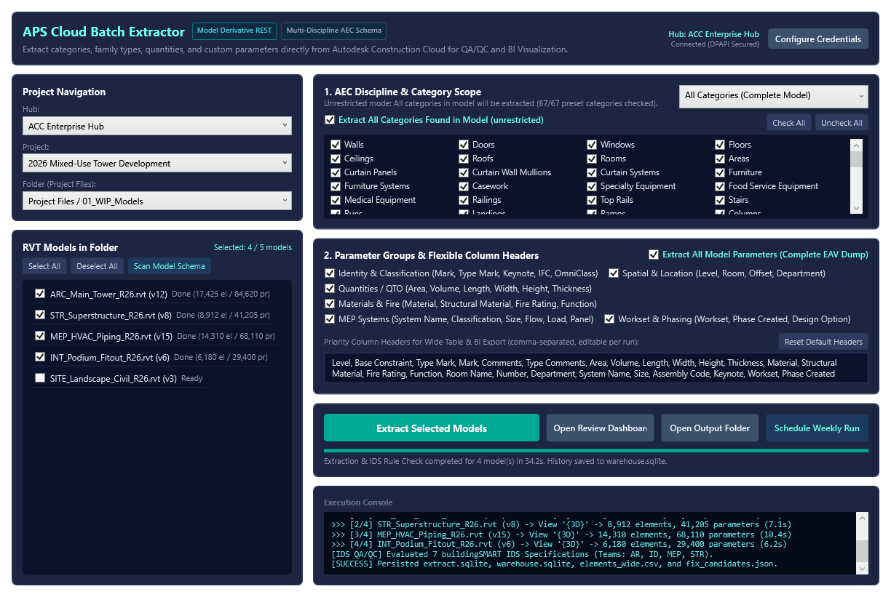
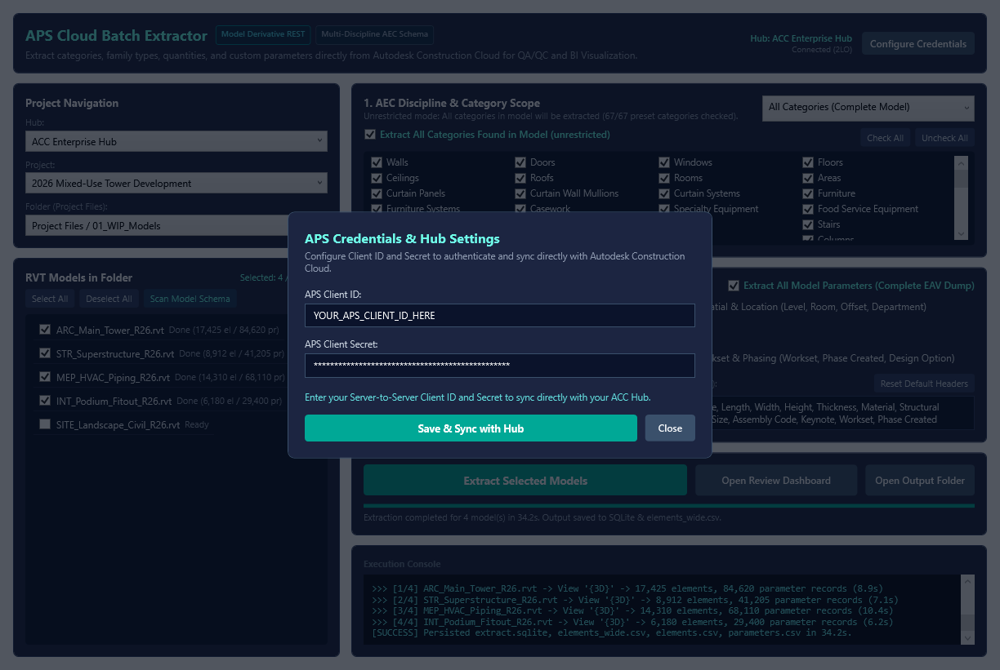
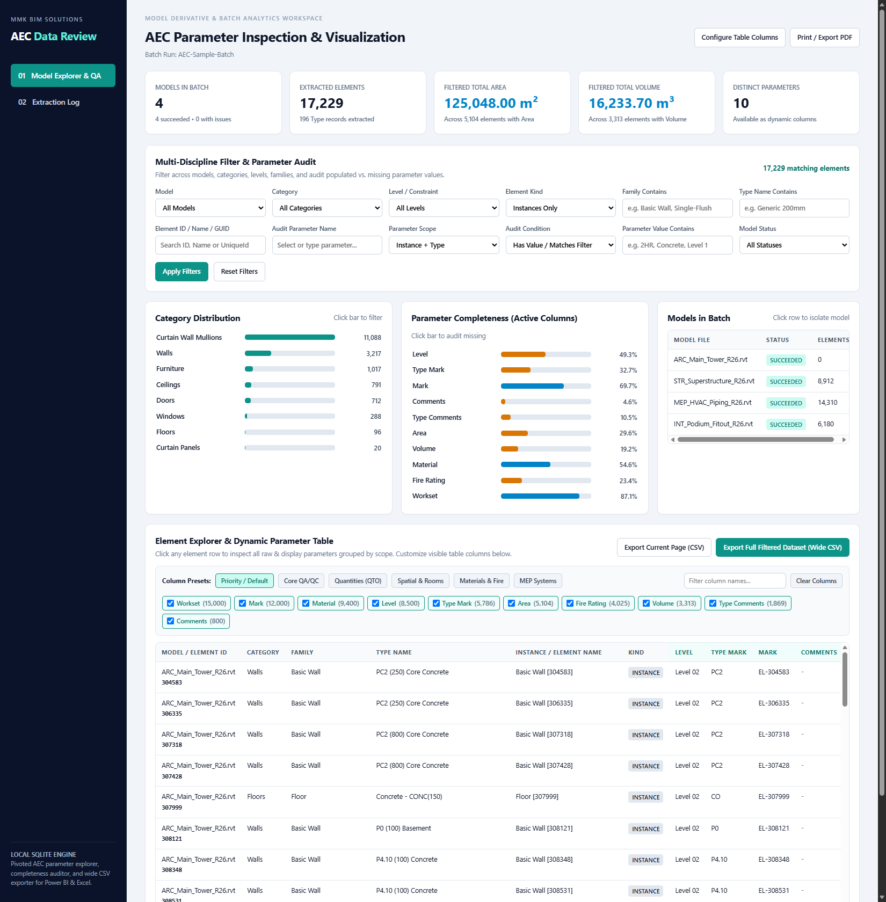

# APS Cloud Batch Data Extractor (`RBDE`)

[](LICENSE)
[](https://dotnet.microsoft.com/)
[](https://learn.microsoft.com/en-us/dotnet/csharp/)
[](https://aps.autodesk.com/)

A fast, practical C# (.NET 8) toolset for extracting Revit element data, everyday BIM parameters, and quantities directly from **Autodesk Construction Cloud (ACC) / BIM 360** in seconds, without downloading `.rvt` files or waiting for Revit to open.

---

## 1. The Problem We Needed to Solve

In a typical project setup with **30+ federated Revit models updated every week**, pulling schedule data for QA/QC and Power BI dashboards usually hits two walls:

1. **Local Batch Extraction Is Too Slow:** Downloading 30+ models (200 to 500 MB each) every week and opening them one by one in desktop Revit takes hours and ties up a machine.
2. **Cloud Headless Revit (Design Automation) Has Long Queues:** During our initial tests with APS Design Automation for Revit 2026 (`src/Automation`), jobs spent **over 10 minutes waiting in the global cloud queue** before a Revit worker VM even booted. When the queue is backed up, it is literally faster to open the file manually.

### The Better Approach: APS Model Derivative REST API
Whenever a model is uploaded or published to ACC Docs, Autodesk already indexes its 3D views and element properties in the background. By querying the **Model Derivative REST endpoints** (`/metadata/{guid}` and `/properties?forceget=true`) directly with a 2-Legged OAuth token:
* We skip downloading the `.rvt` file completely (0 MB local download).
* We skip booting Revit locally or in the cloud.
* Extraction drops from **10+ minutes down to 8-20 seconds per model**.

---

## 2. User Interface & Screenshots

### Main Cloud Batch Extractor (`RBDE.CloudApp.exe`)
Built with C# and WPF (.NET 8). Select your **Hub**, **Project**, and **Folder** from the dropdowns, pick one or all `.rvt` models in that folder, choose your discipline preset or custom column headers, and extract in one batch.



### Credentials & DPAPI Encrypted Hub Sync Popup
To switch between different ACC Hubs or developer accounts without recompiling the code, click **Configure Credentials** in the top right. The popup encrypts your `APS_CLIENT_SECRET` at rest using **Windows DPAPI (`ProtectedData.Protect`, `CurrentUser` scope)** inside `%LOCALAPPDATA%\MMK_BIM\RBDE\credentials.dpapi.json`, automatically removes any legacy plaintext secret from Windows User environment variables, and immediately syncs your accessible Hubs and Projects.



### Local Web Review, 3D Cloud Viewer (SVF2) & QA/QC Dashboard (`RBDE.Dashboard.exe`)
Once extraction finishes, click **Open Review Dashboard** to inspect the SQLite database in your browser:
* **Embedded 60fps 3D Cloud Viewer (`SVF2` Progressive Streaming):** Click **Open 3D Cloud Viewer (SVF2)** in the dashboard header to stream the lightweight translated 3D mesh directly from ACC Cloud (`viewables:read`, 0 Flex Tokens, zero `.rvt` download). Click any row in the Element Explorer, IDS Issues, or Element Diffs table to immediately **isolate and zoom (`fitToView`)** to that object in 3D, click any 3D object to inspect its SQLite parameters, or apply 1-click **3D Heatmaps** (`Color by IDS Issues`, `Color by Team AR/ID/MEP/STR`, `Color by Element Diffs`).
* **Delivery Readiness & Data Confidence Banner:** Shows whether the batch is ready for delivery, with explicit **Data Confidence (`Evaluated X / Y checks (Z%) | K Not Evaluated`)** that separates *"Missing in model"* from *"Invalid numeric value"* and *"Not evaluated (excluded from extraction filter)"*.
* **Element-Level Diff (`Added / Removed / Modified Before -> After`):** Compares models strictly by `project_id + lineage_id` and stable `UniqueId` in `output/warehouse.sqlite` so you can see exact parameter changes (`old_value -> new_value`) between model versions.
* **Issue Lifecycle Tracking (`New / Active / Fixed / Regressed`):** Tracks open issues across runs and verifies when previously reported issues are resolved or reopened.
* **Revit Fix Assistant & Linked-Element Navigator (`src/Revit/FixAssistantCommand.cs`):** Opens as a **modeless** window (`IExternalEventHandler`) inside Revit so you can orbit and inspect elements without closing the dialog. It resolves elements across both the **active Host Document** and all loaded **Revit Links (`RevitLinkInstance`)**, transforms Linked element bounding boxes via `linkInstance.GetTotalTransform()`, highlights linked elements directly in the viewport (`Reference.CreateLinkReference` + `Selection.SetReferences`), zooms any 2D/3D active view (`UIView.ZoomAndCenterRectangle`), or isolates the element with an automatic **3D Section Box** (`View3D.SetSectionBox`). For Host elements, it previews the **Type vs. Instance blast-radius impact** before committing any parameter transaction.



---

## 3. Tested with Practical, Everyday AEC Parameters

Rather than limiting extraction to rigid IDs, the extractor is built and tested around the common parameters that BIM coordinators, architects, engineers, and QS teams actually query every day.

 importantly, the extractor **automatically merges Type parameters onto Instance rows** via the Model Derivative hierarchy tree, and **separates numeric values from units** (for example, `"24.50 m²"` is stored both as display text and as numeric `24.5` with unit `m²`) so you can sum quantities right away.

| Parameter Group | Everyday Parameters Tested & Supported Out-of-the-Box |
| :--- | :--- |
| **Identity & QA/QC** | `Mark`, `Type Mark`, `Comments`, `Type Comments`, `Description`, `Assembly Code`, `Assembly Description`, `Keynote`, `Model`, `Manufacturer`, `Cost`, `OmniClass Number`, `IfcGUID` |
| **Spatial & Location** | `Level`, `Base Constraint`, `Reference Level`, `Schedule Level`, `Upper Limit`, `Base Offset`, `Top Offset`, `Elevation from Level`, `Room Name`, `Room Number`, `Number`, `Department`, `Zone` |
| **Quantities (QTO)** | `Area`, `Volume`, `Length`, `Width`, `Overall Width`, `Height`, `Unconnected Height`, `Thickness`, `Depth`, `Perimeter`, `Count`, `Slope` |
| **Materials & Fire** | `Material`, `Structural Material`, `Finish`, `Wall Finish`, `Floor Finish`, `Ceiling Finish`, `Fire Rating`, `Acoustic Rating`, `Function`, `Structural Usage` |
| **MEP Systems** | `System Type`, `System Name`, `System Classification`, `Service Type`, `Size`, `Overall Size`, `Diameter`, `Flow`, `Voltage`, `Apparent Load`, `Panel`, `Circuit Number` |
| **Worksets & Phasing** | `Workset`, `Phase Created`, `Phase Demolished`, `Design Option` |

*Need custom shared parameters?* Just type any project-specific parameter names into the **Priority Column Headers** box (comma-separated) or leave **Extract All Model Parameters** checked to pull every property group in the model.

---

## 4. Two Ways to Run: Standalone App vs. Inside Revit

All core extraction logic, API clients, SQLite storage, and UI are written in **100% compiled C# (.NET 8)**. You can deploy and launch the tool in two ways depending on your team's workflow:

### Option A: Standalone Desktop App (No Revit Required)
Run `bin/CloudApp/RBDE.CloudApp.exe` directly from Windows Desktop or a shortcut. Since it talks directly to the APS REST API, **you do not need Revit installed on the machine**. Project managers, QS engineers, or data analysts can pull model data from ACC on any standard laptop.

### Option B: Launched from Inside the Revit Ribbon
If your BIM modellers prefer clicking a button directly inside Revit:
1. **Native C# Add-in (`src/Revit`):** Compiles into a standard Revit 2026 `.dll` (`IExternalCommand`) for local model extraction.
2. **Lightweight pyRevit Ribbon Shortcut (Recommended for fast rollout):** You can place a simple `.pushbutton` inside a custom pyRevit tab that calls `os.startfile("RBDE.CloudApp.exe")`.
   * *Note on Architecture:* **We do not use Python/IronPython to run the extraction.** pyRevit is only used here as a convenient UI button host to bypass Revit `.addin` DLL locking and allow instant updates while the compiled C# `.NET 8` application does all the heavy lifting.

---

## 5. Benchmark Results (Real ACC Model Test)

Tested on a production **357.62 MB Revit 2026 Architecture model** hosted on ACC (`17,425` elements across `31` categories):

| Metric | Manual / Local Revit Batch | APS Design Automation (Cloud VM) | APS Model Derivative REST (`RBDE.CloudApp`) |
| :--- | :--- | :--- | :--- |
| **Local File Download** | 357.62 MB per file | 0 MB (Cloud S3 to VM) | **0 MB** |
| **Queue & Boot Wait** | 3-6 min per model | 8-12 min (Global queue pos ~100+) | **0 sec (Direct HTTP GET)** |
| **Extraction Time (1 Model)** | ~4-7 min | ~10+ min total | **8.4 - 20.1 seconds** |
| **Estimated Time (30 Models)** | ~2.5 - 3.5 hours | ~15 - 45 min | **~3 - 6 minutes** |

---

## 6. Setup & Quick Start

### 1. Prerequisite: ACC Custom Integration
1. Create a **Server-to-Server (2-Legged OAuth)** app in the [Autodesk Platform Services Portal](https://aps.autodesk.com/) with **Data Management API** and **Model Derivative API** enabled.
2. In **ACC Account Admin > Custom Integrations**, add your **Client ID** with access to **DOCS / Project Administration**.
3. **Security Rule:** Never hardcode your Client ID or Secret into code files. Enter them inside the app's **Configure Credentials** popup, which encrypts `APS_CLIENT_SECRET` using Windows DPAPI (`CurrentUser` scope) at `%LOCALAPPDATA%\MMK_BIM\RBDE\credentials.dpapi.json`.

### 2. Build & Run
```powershell
# Build the Web Dashboard and publish the Desktop App
dotnet build src/Dashboard/Dashboard.csproj -c Release
dotnet publish src/CloudApp/CloudApp.csproj -c Release -o bin/CloudApp

# Start the application (interactive UI or headless scheduled mode)
./bin/CloudApp/RBDE.CloudApp.exe
./bin/CloudApp/RBDE.CloudApp.exe --headless --project "Project Name"
```

### 3. Output Files & IDS-Inspired Rule Schema
Every run generates a timestamped folder under `output/batch-YYYYMMDD-HHMMSS/` and updates `output/warehouse.sqlite`:
* **`elements_wide.csv`**: Pivoted flat table (`1 row = 1 element`) where your selected parameters (`Level`, `Type Mark`, `Mark`, `Comments`, `Area`, `Volume`, `Material`, `Fire Rating`, `Workset`, etc.) are ready-to-use column headers for Power BI and Excel.
* **`extract.sqlite` & `output/warehouse.sqlite`**: Per-run SQLite database and cross-run historical warehouse storing `models`, `elements`, `parameters`, `issues`, `confidence_summary`, `element_diffs`, and `issue_registry`.
* **`rules.ids.json`**: Uses an internal JSON rule schema (`RBDE-IDS-Inspired-1.0-JSON`) modeled on buildingSMART IDS facets (`applicability` + `requirements` with `propertySet`, `scope`, `pattern`, `minInclusive`, and `maxInclusive`) and grouped by responsible team code (`AR`, `ID`, `MEP`, `STR`).
* **`fix_candidates.json`**: Team-filtered issue package consumed by the Revit Fix Assistant (`FixAssistantCommand`).

---

## 7. Minimum Cost & APS Token Breakdown for Heavy Production Use

If your team plans to run this at scale across dozens of projects, here is the realistic cost breakdown:

| Component / Service | What You Need | Actual Cost / Token Rate |
| :--- | :--- | :--- |
| **ACC / BIM 360 Docs Subscription** | Active ACC Docs hub where project `.rvt` files are hosted + Account Admin rights to register the Custom Integration | Included in existing ACC Docs / AEC Collection seats |
| **APS Developer Account** | Standard APS app credentials (`Client ID` & `Client Secret`) | **$0.00** (Free tier includes Data Management & Model Derivative GET calls) |
| **Model Derivative GET API (`RBDE.CloudApp` Default)** | Reading `/metadata` and `/properties` from models already uploaded to ACC Docs | **$0.00 (0 Flex Tokens)**. ACC automatically translates models when uploaded; reading that property tree via GET does not consume tokens. |
| **Model Derivative POST Job *(Only if translating files outside ACC)*** | Triggering manual SVF2 translation on custom OSS buckets | **0.5 Flex Tokens** (~$1.50 USD) per model translation |
| **Design Automation API *(Optional Fallback in `src/Automation`)*** | Running a headless Revit cloud VM | **6 Flex Tokens / hour** (~$18.00 USD per VM hour) |
| **Enterprise High-Volume Scaling** | Staying within APS rate limits (~100-500 requests/min) when pulling 100+ models at once | **$0.00 API fee** for GET requests; if you need paid tokens for custom POST translations or Design Automation, an **APS Flex Pack starts at 100 Tokens (~$300 USD/year)**. |

**Note on APS Offerings & Pricing:** Reading already-translated ACC / BIM 360 Docs properties via Model Derivative GET endpoints does not trigger new cloud translation jobs. However, Autodesk APS tier limits, rate limits, and token pricing for custom POST translations or Design Automation jobs depend on your organization's active Autodesk APS offering and contract; always verify current quotas in your APS Developer Portal.

---

## 8. Future Roadmap

* **Webhook Auto-Trigger (`dm.version.added`):** Automatically extract model data in the background whenever a new version is published on ACC.
* **AEC Data Model GraphQL Option:** Support Autodesk's GraphQL endpoint for server-side filtering on specific parameter subsets.
* **Direct Parquet / DuckDB Export:** Output `.parquet` files alongside `elements_wide.csv` for faster Power BI loading on million-row multi-project datasets.

---

## 9. License

This project is licensed under the **[MIT License](LICENSE)**.
